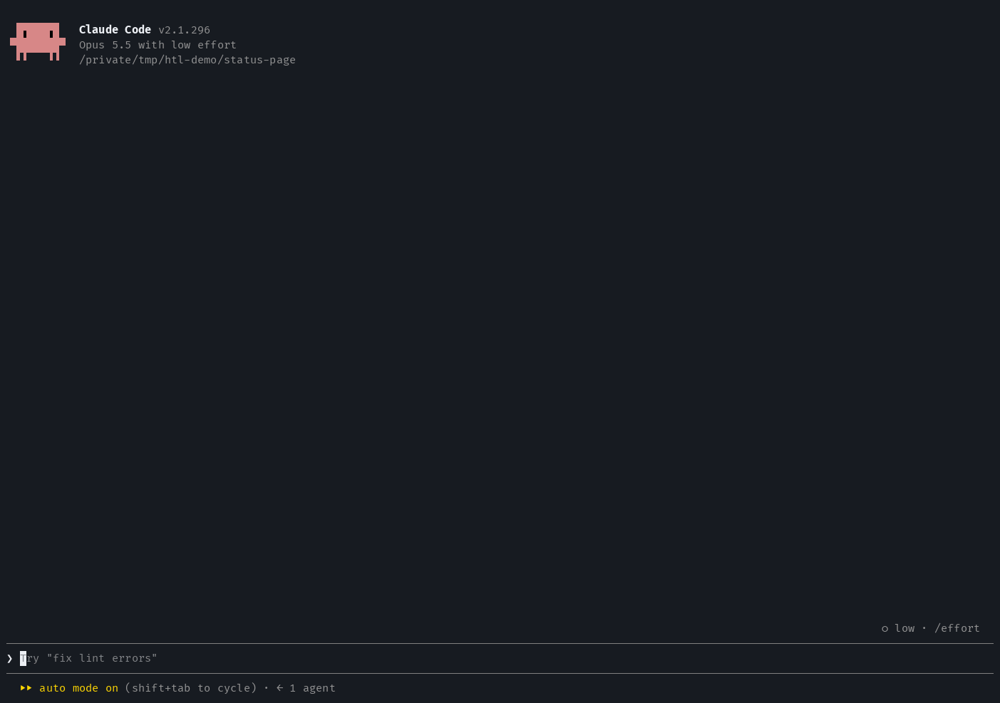

# htl: human in the loop

Sometimes an AI coding agent hits a job it truly cannot do: a login with 2FA, a
secret that does not exist yet, a cable to plug in, a payment, or a machine it
cannot reach. htl lets the agent hand you that job as a **task**. You answer in
a pane (Accept, Reject or "You can do this", with an optional message), and the
agent carries on.



## Harnesses

A harness is the coding tool htl runs in. Each one has its own folder, and all
of them share the logic in [`packages/core`](packages/core/README.md).

| Harness     | Folder                                                     | Status    |
| :---------- | :--------------------------------------------------------- | :-------- |
| Claude Code | [`harnesses/claude-code`](harnesses/claude-code/README.md) | Available |
| opencode    |                                                            | Planned   |
| pi          |                                                            | Planned   |

## Install in Claude Code

htl needs Claude Code 2.1.300 or later. Add one of its two marketplaces, then
install it:

```shell
/plugin marketplace add lifebugz/htl
/plugin install htl@htl
```

Or from the [lifebugz marketplace](https://github.com/lifebugz/cc-marketplace),
which lists other plugins too:

```shell
/plugin marketplace add lifebugz/cc-marketplace
/plugin install htl@lifebugz
```

Install it from one marketplace only. Both list a plugin named `htl`, and when
two enabled plugins have the same name, Claude Code loads the hooks module of
only one of them.

If you already have `htl@lifebugz`, keep it: do not also install `htl@htl`.
This command updates it to the version the lifebugz marketplace pins (it
refreshes the marketplace first); then restart Claude Code:

```shell
claude plugin update htl@lifebugz
```

htl keeps no data on disk: its tasks live only in the running session. So an
update loses nothing except open tasks, because a new session starts with none.
Answer them before you restart.

The [Claude Code guide](harnesses/claude-code/README.md) explains how to use
htl.

## Layout

```
packages/core/          the logic every harness shares, and the only place it is edited
harnesses/claude-code/  the Claude Code plugin: the folder the marketplaces install
  hooks/core/           generated: a copy of packages/core/src
tooling/                TypeScript and ESLint configs, the Claude Code mod API types, scripts
docs/media/             the images in the READMEs
```

Claude Code installs only the plugin folder, and a hooks module can import only
files inside its plugin. So `bun run core:sync` copies core into the plugin, and
`bun run core:check` fails when a copy differs from its source. Each copy starts
with a `GENERATED` line; edit the source in `packages/core`, never the copy.

`tooling/` is the same as in [lifebugz/typofix](https://github.com/lifebugz/typofix),
so a fix in one repository can be copied to the other. Two files differ:
`tooling/scripts/sync-core.ts` copies no assets, because htl has none, and
`tooling/scripts/check-types-version.sh` names htl in its message.

## Develop

You need [Bun](https://bun.com) and Claude Code. From the repository root:

```shell
bun install
bun run check
```

`bun run check` runs these in order, and must pass with zero warnings:

| Script         | What it runs                                                                        |
| :------------- | :---------------------------------------------------------------------------------- |
| `types:check`  | Fails when `tooling/types/` is older than the installed Claude Code                 |
| `core:check`   | Fails when a copy of `packages/core` in a harness differs from its source           |
| `typecheck`    | TypeScript 7 on each project: the tooling, core, core's tests, the plugin           |
| `lint`         | ESLint with type information, one process each for the tooling, core and the plugin |
| `format:check` | Prettier over the whole repository                                                  |
| `test`         | `bun test` for core, then `claude plugin test` for the plugin                       |
| `validate`     | `claude plugin validate --strict` for the plugin and for the marketplace            |

After a change in `packages/core`, run `bun run core:sync` and commit the source
and its copies together.

ESLint, TypeScript and one test keep the parts apart:

- Core imports only its own files, never a package or a host API.
- Core's TypeScript project has no host types, so `process`, `Bun` or a file
  API does not type-check there. A harness does all I/O (the pane, the tool,
  the prompt, processes) and passes plain values to core.
- Harness code imports core only through `core/index`, its public API.
- Core takes each harness's own words as parameters: the tool's name, the
  command, the agent's name. So core's texts name no harness, and
  `packages/core/tests/terms.test.ts` checks it.

The mod API types in `tooling/types/` are copied from the ones Claude Code
writes beside a plugin it loads. After a Claude Code update, start it once with
`claude --plugin-dir harnesses/claude-code`, then run `bun run types:sync` and
commit `tooling/types/`.

CI runs `bun run check` with the Claude Code version that wrote
`tooling/types/`. With the oldest Claude Code htl supports (2.1.300), it runs
`claude plugin validate --strict` on the plugin and on the marketplace, and
`claude plugin test` on the plugin. If that version lacks one of these
commands, CI warns but does not fail.

## Release

A release is a new `version` in a plugin's `plugin.json`; there are no git tags
or GitHub Releases. Today only the Claude Code plugin has releases; each new
harness adds its own part below.

### Claude Code

htl reaches Claude Code users through two marketplaces, and each one sees a
release in its own way.

| Plugin id      | Marketplace, where its entry is                                                                          | The entry installs                                                | An installed copy can update, at the user's next `claude plugin update`, once |
| :------------- | :------------------------------------------------------------------------------------------------------- | :---------------------------------------------------------------- | :---------------------------------------------------------------------------- |
| `htl@htl`      | lifebugz/htl (this repository), `.claude-plugin/marketplace.json`                                        | `harnesses/claude-code` as it is on `main`                        | `version` changes on `main`                                                   |
| `htl@lifebugz` | [lifebugz/cc-marketplace](https://github.com/lifebugz/cc-marketplace), `.claude-plugin/marketplace.json` | `harnesses/claude-code` at the one commit the entry's `sha` names | the `sha` moves to a commit with a new `version`                              |

Three rules decide what users get:

- **The version.** An installed copy updates only when the plugin's version
  changes, and `version` in `harnesses/claude-code/.claude-plugin/plugin.json`
  sets it. Auto-update is off by default for both marketplaces, so users get a
  new version when they run `claude plugin update htl@htl` (or
  `htl@lifebugz`), which refreshes the marketplace first, unless they turned
  auto-update on. When the version is the same, that command says so, for
  example `htl is already at the latest version (0.2.1).`
- **New installs.** `claude plugin install htl@htl` refreshes the marketplace
  first and copies `harnesses/claude-code` from `main` as it is at that moment,
  under whatever version it names. So a merge that keeps the version still
  reaches new users, and two copies that both say 0.2.1 can differ. Raise the
  version whenever the plugin folder changes.
- **The pinned commit.** Claude Code installs exactly the commit that the
  cc-marketplace entry's `sha` names. A change here reaches `htl@lifebugz`
  users only once that `sha` moves to a commit that contains it: new installs
  then get that commit, and existing installs update if its `version` is new.

A change needs a release when it changes a file under `harnesses/claude-code/`.
That includes `packages/core/src`, because `bun run core:sync` copies it into
that folder. A change to `tooling/`, core's tests or this README needs none. An
edit to this repository's `.claude-plugin/marketplace.json`, such as a new
description, needs none either: it reaches `htl@htl` users the next time their
copy of the marketplace refreshes, for example at their next
`claude plugin update htl@htl`.

To release 0.2.2:

1. Make the change on a branch. If `packages/core` changed, run
   `bun run core:sync`.
2. In `harnesses/claude-code/.claude-plugin/plugin.json`, raise `version` from
   `0.2.1` to `0.2.2`.
3. Run `bun run check`, push the branch, and open a pull request. CI publishes
   nothing, and `main` has no rule that blocks a merge when CI fails, so merge
   only after CI passes. The merge into `main` is the release: from then on,
   `htl@htl` users get 0.2.2 at their next `claude plugin update`.
4. Find the commit your merge created on `main` (the pull request page shows
   it). CI runs again on that push to `main`; check that it passed. If nothing
   was merged after yours, `git fetch origin` and then
   `git rev-parse origin/main` print its full id. The `sha` field takes only
   the full 40 characters.
5. On lifebugz/cc-marketplace, open a pull request that sets the `htl` entry's
   `sha` to that id. When a maintainer of that repository merges it,
   `htl@lifebugz` users get 0.2.2 at their next `claude plugin update`.

What each step reaches, for users who already have 0.2.1:

| You did                                      | `htl@htl`                                   | `htl@lifebugz`                   |
| :------------------------------------------- | :------------------------------------------ | :------------------------------- |
| Merged a change and kept `version` at 0.2.1  | stay on 0.2.1 (new installs get the change) | stay on 0.2.1 (new installs too) |
| Merged the change with `version` 0.2.2 (1-3) | 0.2.2                                       | stay on 0.2.1                    |
| Then merged the `sha` pull request (4-5)     | 0.2.2                                       | 0.2.2                            |

`claude plugin list` shows the version each install has.

## License

[MIT](LICENSE)
